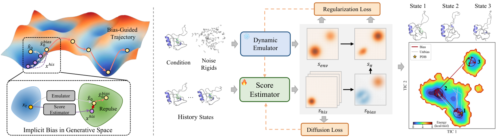
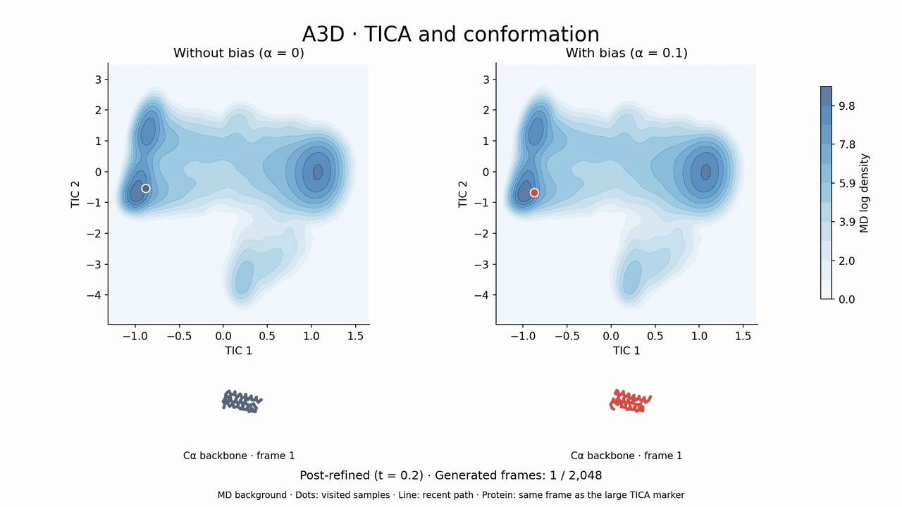
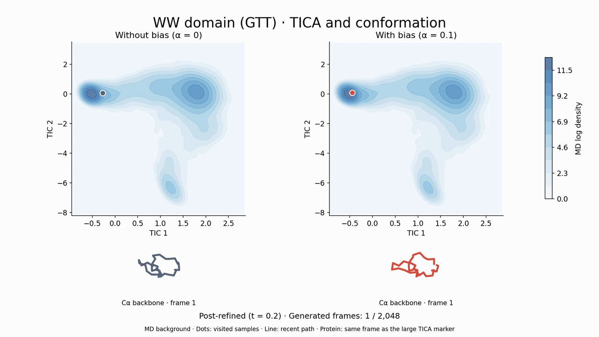
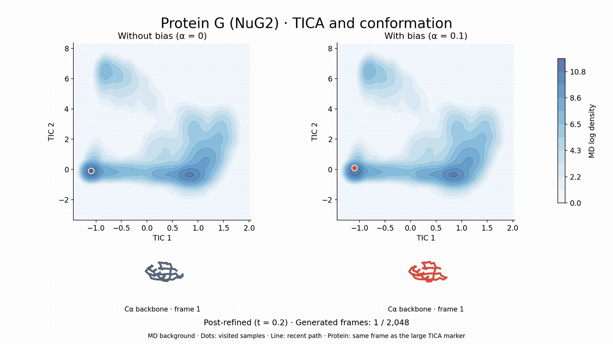

# IMD: Learning Implicit Bias in Generative Spaces for Accelerating Protein Dynamics Emulation

Kaihui Cheng, Zhiqiang Cai, Wenkai Xiang, Zhihang Hu, Siyu Zhu, Tzuhsiung Yang, Yuan Qi

[](https://arxiv.org/abs/2606.01833)
[](LICENSE)
[](pyproject.toml)

IMD learns a history-dependent bias that helps a frozen protein dynamics emulator
explore beyond previously visited conformations. This repository provides the
**AlphaFold/OpenFold-based implementation**: sequence representations, an SE(3)
diffusion emulator, supervised training of the history-aware score estimator,
guided sampling, and structural evaluation.

[Paper](https://arxiv.org/abs/2606.01833) · [Demo video](assets/imd_demo.mp4) ·
[Installation](#installation) · [Data preparation](docs/data.md) ·
[Checkpoints](docs/checkpoints.md) · [Citation](#citation)



**Figure 1.** IMD combines a frozen emulator with a history-aware score estimator.
The learned bias changes as the trajectory history grows, steering sampling
toward less-visited conformations. From [the paper, Figure 1](https://arxiv.org/html/2606.01833v2#S2.F1);
© Cheng et al., 2026, [CC BY 4.0](https://creativecommons.org/licenses/by/4.0/).

> **Code release:** pretrained checkpoints will be released separately. Guided
> sampling requires environment and estimator weights; estimator training requires
> a pretrained environment and prepared trajectories. See the [release scope](docs/release.md).

## TICA demos

**First 2,048 generated frames per run, after refinement (t=0.2).** Compare
sampling without bias (α=0) with IMD bias (α=0.1). For each protein, both runs
share the same MD-fitted TICA plane and MD distribution background. **Large square TICA panels** compare the
unbiased run on the left with the biased run on the right. A **synchronized 3D
Cα backbone** sits below each plot, showing the same frame as its large TICA
marker with a shared fixed view and scale.
Dots accumulate visited samples alongside a recent path. **Both runs receive
the same post-refinement procedure**, and the TICA projections are recomputed
from the refined structures. Playback follows the original generated-frame order.

**A3D** · [1080p MP4](assets/imd_demo.mp4)

[](assets/imd_demo.mp4)

**WW domain (GTT)** · [1080p MP4](assets/ww_domain_demo.mp4)

[](assets/ww_domain_demo.mp4)

**Protein G (NuG2)** · [1080p MP4](assets/protein_g_demo.mp4)

[](assets/protein_g_demo.mp4)

Render any protein from precomputed projections and corresponding trajectories:

```bash
python scripts/animate_tica.py \
  --reference path/to/md_tica.npy \
  --baseline path/to/no_bias_refined_tica.npz \
  --biased path/to/bias_refined_tica.npz \
  --baseline-pdb path/to/no_bias_refined.pdb \
  --biased-pdb path/to/bias_refined.pdb \
  --protein A3D --alpha 0.1 --max-frames 2048 --refinement-start-t 0.2
```

[Input format and source configuration](assets/README.md#tica-demo)

## How it works

1. **Learn from history.** Train a history-aware score estimator with supervised
   denoising targets and an environment-support regularizer, keeping the emulator frozen.
2. **Bias reverse sampling.** Combine the estimator and emulator scores with
   distance-dependent history weights to discourage repeated visits.
3. **Extend exploration.** Update the history bank during autoregressive rollout.
   The paper additionally evaluates score-based refinement for long-horizon samples.

The estimator is called the **actor** in the source code and configuration keys.
The released training procedure is supervised score matching with environment
support. The demos use precomputed post-refined trajectories; the separate
refinement workflow is outside this initial code release. The renderer labels
and visualizes these inputs without performing refinement itself.

Selected results reported in [the paper](https://arxiv.org/abs/2606.01833):

| Benchmark | Reported gain over the unbiased emulator |
| --- | --- |
| DynamicPDB-80 | **35%** higher diversity measured by mDiv-mean |
| 12 zero-shot Fast-Folding proteins | Up to **~15×** faster time-to-coverage with bias alone; **~37×** with bias + refinement |
| Low-energy-state coverage on Fast-Folding | **~3×** with bias + refinement |

Time-to-coverage compares generated-frame budgets, rather than end-to-end runtime.
The demos above are qualitative examples; they do not reproduce these aggregate results.

## Installation

The reference environment is **Linux, Python 3.10, and PyTorch 2.6.0**. CUDA is
required for practical training and sampling; numerical tests run on CPU.
PyTorch 2.6 supplies the flex-attention APIs used by the model.

```bash
git clone https://github.com/Kaihui-Cheng/IMD.git
cd IMD
python3.10 -m venv .venv
source .venv/bin/activate
python -m pip install --upgrade pip
python -m pip install torch==2.6.0 --index-url https://download.pytorch.org/whl/cu124
python -m pip install -r requirements.txt
```

Dependencies are pinned in [pyproject.toml](pyproject.toml). FlashAttention and
DeepSpeed are optional. Evoformer embedding extraction uses a **separate upstream
OpenFold installation**; the vendored `openfold/` package contains the structural
utilities needed by IMD. See [data preparation](docs/data.md).

## Prepare data and checkpoints

Follow [data preparation](docs/data.md) and [checkpoint setup](docs/checkpoints.md).
The files in [examples/](examples/) are CSV format templates with placeholder paths.

```text
checkpoints/
  env_model.pth
  actor/pytorch_model.bin
data/
  train.csv
  val.csv
  inference.csv
  embeddings/
  coordinates/
```

## Guided sampling

With local data and checkpoints in place:

```bash
bash scripts/sample.sh \
  data.test_csv_path=data/inference.csv \
  model.pretrained_weights=checkpoints/env_model.pth \
  actor.weight=checkpoints/actor/pytorch_model.bin \
  eval.output_dir=outputs/samples
```

The released defaults use **unnormalized distance weights, σ=1, H=3, α=0.1**.
The output contains 16 segments of 16 frames per protein, saved as multi-model
PDB files in `outputs/samples/mode_2/`. Override the bias strength with
`experiment.actor_blend_alpha=0.2`. To run an unbiased environment baseline, use
`experiment.actor_blend_alpha=0 actor.weight=null`.

Sampling history length is `experiment.max_history`; training history length is
`data.history_frames`. See [usage and configuration notes](docs/usage.md) for
history weighting options and the mapping to paper terminology.

## Supervised estimator training

```bash
NUM_PROCESSES=1 bash scripts/train_actor.sh \
  data.train_csv_path=data/train.csv \
  data.test_csv_path=data/val.csv \
  model.pretrained_weights=checkpoints/env_model.pth \
  experiment.save_dir=checkpoints/supervised_pretrain
```

For multiple GPUs, set `CUDA_VISIBLE_DEVICES` and `NUM_PROCESSES` together.
The default objective combines history-conditioned score matching and forward-KL
environment support; score-space history repel is disabled. Accelerate checkpoint
directories contain `pytorch_model.bin`. Environment-model training is described
in [the usage guide](docs/usage.md#environment-training).

## Structural evaluation

The reference CSV also needs `pdb_path` and `traj_path` for the matching MD
trajectory. Generated filenames must match its `pdb_id` values.

```bash
python -m metrics.structural_metric \
  --input_csv data/reference.csv \
  --gen_root outputs/samples/mode_2 \
  --save_dir outputs/metrics \
  --jobs_name imd \
  --device cpu
```

This reports diversity, precision/recall, and structural validity. Study-specific
TICA/FES analysis and benchmark aggregation are outside this initial release.

## Repository layout

```text
DyneTrion/         Training/sampling entry points and Hydra configurations
src/model/        Environment, history-aware estimator, and attention modules
src/data/         Protein loaders, geometry, and SE(3) diffusion
src/analysis/     Structure output and alignment utilities
openfold/         Required OpenFold/AlphaFold structural utilities
datasets/toolbox/ Data preprocessing tools
metrics/          Structural evaluation
scripts/          Launchers and demo rendering
assets/           Paper Figure 1 and demo media
examples/         CSV format templates
tests/            Checkpoint-free tests
docs/             Data, checkpoints, usage, and release notes
```

The `DyneTrion` and `src` namespaces are retained from the research implementation.
The public estimator module is `src.model.actor`; saved parameter names are preserved.

## Development

```bash
python -m pip install -r requirements-dev.txt
python -m pytest
python -m build
```

See [CONTRIBUTING.md](CONTRIBUTING.md). Tests use synthetic inputs and cover the
code workflow; they do not validate the unreleased pretrained checkpoints.

## Citation

If you use IMD, please cite [our paper](https://arxiv.org/abs/2606.01833):

```bibtex
@article{cheng2026learningimplicitbias,
  title   = {Learning Implicit Bias in Generative Spaces for Accelerating Protein Dynamics Emulation},
  author  = {Cheng, Kaihui and Cai, Zhiqiang and Xiang, Wenkai and Hu, Zhihang and Zhu, Siyu and Yang, Tzuhsiung and Qi, Yuan},
  journal = {arXiv preprint arXiv:2606.01833},
  year    = {2026},
  doi     = {10.48550/arXiv.2606.01833},
  url     = {https://arxiv.org/abs/2606.01833}
}
```

Machine-readable metadata is available in [CITATION.cff](CITATION.cff).

## License and acknowledgments

Project code is released under [Apache-2.0](LICENSE). Figure 1 retains the paper's
CC BY 4.0 license; see [media attribution](assets/README.md). Upstream code retains
its original notices in [THIRD_PARTY_NOTICES.md](THIRD_PARTY_NOTICES.md).

This implementation builds on AlphaFolding/DyneTrion, OpenFold, AlphaFold,
Wan/Self-Forcing attention components, and BioEmu structural helpers. Weights and
datasets will have separate distribution terms.
